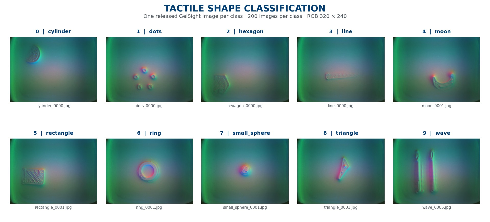
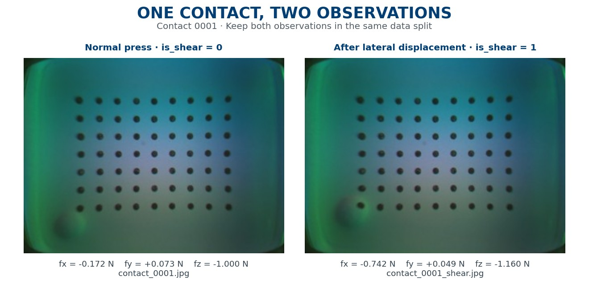

# Deep Learning — Final Coursework 2026–2027

## Part A: Learning from Tactile Images

**Imperial College London · Department of Bioengineering**

This coursework develops practical experience in deep learning through two problems in tactile perception: recognising object shape and estimating contact forces from images. Using a curated subset of the TacVerse dataset, students design, train and evaluate neural networks for multiclass classification and three-dimensional regression.

The work connects model design with experimental practice. Students examine the structure of the data, construct reproducible training and evaluation splits, compare alternative architectures, and interpret both successful predictions and failure cases. The final submission combines an evidence-based technical report with code and models that support independent evaluation.

**[Project handbook](resources/2026_2027_DL_Final_Project_Handbook_Shared.pdf)** · **[Getting started](docs/GETTING_STARTED.md)** · **[Download dataset · 37.44 MB](https://github.com/dianzdd123/2026-2027-Deep-Learning-Final-Coursework-Part-A/releases/download/v1.0.0/Tactile_DL_2027.zip)** · **[Assessment and deadlines](docs/ASSESSMENT_OVERVIEW.md)**

[](https://colab.research.google.com/github/dianzdd123/2026-2027-Deep-Learning-Final-Coursework-Part-A/blob/main/notebooks/01_explore_dataset.ipynb)

## Course information

| Item | Details |
|---|---|
| Module | Deep Learning |
| Academic year | 2026–2027 |
| Module leader | Dr Dandan Zhang |
| Teaching assistant | Ms Lan Wei |
| Coursework component | Part A: individual technical coursework, 60 marks |
| Submission | Report, code and models in one ZIP file on Canvas |
| Deadline | Sunday 13 December 2026, 23:59 UK time (GMT) |
| Computing environment | Python; Google Colab or a local notebook environment |

The [Final Project Handbook](resources/2026_2027_DL_Final_Project_Handbook_Shared.pdf) defines the assessment requirements. These repository materials explain the dataset and support implementation. Consult Canvas for module-team announcements and subsequent clarifications.

## Learning objectives

By completing the Part A tasks, students will practise how to:

- Formulate tactile perception as supervised classification and regression problems.
- Inspect image data and labels, identify dependencies between samples, and construct valid evaluation splits.
- Implement and compare neural-network architectures under a consistent experimental protocol.
- Select models using validation evidence and evaluate generalisation on held-out data.
- Interpret classification errors and force-estimation errors, including the distinction between normal and tangential forces.
- Communicate methodological choices and limitations, and package a reproducible inference pipeline.

### Recommended preparation

Useful preparation includes Python programming, array operations, basic linear algebra, and the concepts of loss functions, gradient-based optimisation, overfitting and regularisation. Familiarity with convolutional neural networks and training, validation and test sets will support the project work. The [exploration notebook](notebooks/01_explore_dataset.ipynb) introduces this dataset's organisation and labels before model development begins.

## Course materials

| Resource | Purpose |
|---|---|
| [Final Project Handbook](resources/2026_2027_DL_Final_Project_Handbook_Shared.pdf) | Assessment specification for Parts A and B, including marking criteria and submission policies |
| [Handbook reading map](resources/README.md) | Direct links to the relevant handbook sections and PDF pages |
| [Getting started](docs/GETTING_STARTED.md) | Dataset access, environment setup and the first data-inspection steps |
| [Dataset card](docs/DATASET_CARD.md) | Provenance, file structure, label definitions, measured statistics and limitations |
| [Part A assignment guide](docs/COURSEWORK_GUIDE.md) | Required experiments, evaluation measures, report structure and submission interface |
| [Assessment overview](docs/ASSESSMENT_OVERVIEW.md) | Dates, deliverables, marks, optional bonuses and academic-integrity requirements |
| [Exploration notebook](notebooks/01_explore_dataset.ipynb) | Guided loading, verification and visual inspection of the released data |
| [Submission example](example_submission/) | Reference interface for loading model weights and producing prediction files |

Guidance for the separate group project is provided in the [Part B project guide](docs/PART_B_GUIDE.md).

## Dataset

The release contains 4,000 RGB tactile images at 320 × 240 pixels. The two tasks use different GelSight sensor configurations and target representations.

| Property | Shape classification | Force estimation |
|---|---|---|
| Handbook task | Task 2 | Task 3 |
| Learning problem | Ten-class image classification | Three-output regression |
| Sensor configuration | GelSight without markers | GelSight with markers |
| Images | 2,000; 200 per class | 2,000; 1,000 paired contacts |
| Target | Class ID from 0 to 9 | Force vector `fx`, `fy`, `fz`, in newtons (N) |
| Relationship between samples | Images grouped by shape class | A press image and a shear image for each `contact_id` |
| Evaluation split | Stratified by class | Grouped by contact |

A vision-based tactile sensor records the deformation of a compliant contact surface. These images provide information about contact geometry and loading. The shape task examines whether a model can distinguish contact patterns; the force task examines whether image features support quantitative estimates of physical interaction.



*One released image from each shape class. Labels follow the coursework's supplied class mapping.*



*Paired observations share a contact identifier and must remain in the same training, validation or test split.*

The complete archive includes the images, labels, original dataset documentation and example submission files. Download it from the [dataset release](https://github.com/dianzdd123/2026-2027-Deep-Learning-Final-Coursework-Part-A/releases/download/v1.0.0/Tactile_DL_2027.zip). GitHub's **Code → Download ZIP** contains the repository documentation and utilities; the image archive is a separate release asset. See [Getting started](docs/GETTING_STARTED.md) for verified download and extraction instructions.

The source archive uses the legacy names “Task A” and “Task B” for shape classification and force estimation. Both belong to the individual coursework **Part A**. They are distinct from the separate group project, **Part B**.

## Part A assignments

| Handbook task | Required work | Marks |
|---|---|---:|
| Task 1 — Data preparation | Examine images and label distributions; prepare pixel and force normalisation; construct valid 60/20/20 splits | 10 |
| Task 2 — Shape classification | Implement and compare at least three CNN architectures; evaluate classification performance, efficiency and failure cases | 20 |
| Task 3 — Force estimation | Compare at least two architectures; evaluate force errors and the required press/shear tangential analysis against a training-mean baseline | 20 |
| Task 5 — Technical report | Present methods, experimental evidence, analysis and limitations in the prescribed report format | 10 |

Task 4, systematic hyperparameter tuning, is optional and can earn up to five bonus marks. Other optional work and the combined bonus cap are specified in the [assessment overview](docs/ASSESSMENT_OVERVIEW.md). The [Part A assignment guide](docs/COURSEWORK_GUIDE.md) provides the full requirements and their handbook references.

### Experimental practice

Create reproducible splits containing 60% training, 20% validation and 20% test data. For shape classification, stratification gives 120 training, 40 validation and 40 test images per class. For force estimation, split the 1,000 contact identifiers into 600, 200 and 200 contacts, respectively, retaining both images of each contact together.

Fit data-dependent preprocessing on the training split and use validation data for model selection. Reserve the test split for final evaluation. Record random seeds, split membership and experimental settings. The handbook permits a declared final refit on training and validation data after model selection; the test set must remain untouched.

Report classification accuracy, macro precision, macro recall, macro F1 and a confusion matrix. Report force errors in newtons, including the prescribed per-axis, overall and tangential RMSE measures, separate press/shear results, baseline comparison and failure analysis. Exact definitions appear in the [assignment guide](docs/COURSEWORK_GUIDE.md).

For Part A, use only the released coursework data. Additional tactile datasets and other TacVerse images are excluded; general-purpose pretrained weights, such as ImageNet weights, are permitted with citation. See [handbook Section 11.3](resources/2026_2027_DL_Final_Project_Handbook_Shared.pdf#page=41).

## Report and submission

The Part A report uses the IEEE conference format, double column, and is 3–6 pages long. References and the AI-use declaration may extend beyond page 6. Submit `DL_Coursework_YourName_CID.zip` through Canvas, containing the report, a `code/` folder and a model folder named with your eight-digit CID.

The prediction interface accepts a directory of anonymous images and produces one output row per image:

```bash
python predict.py --task shape --images <IMAGE_DIR> --out <OUT_CSV>
python predict.py --task force --images <IMAGE_DIR> --out <OUT_CSV>
```

Shape output uses `filename,class_id`; force output uses `filename,fx,fy,fz`, with forces on their original scale in newtons. The model folder must be under 200 MB, support CPU execution, and complete each task within ten minutes on a Colab GPU. Prediction must run without downloads. See [handbook Section 5.4](resources/2026_2027_DL_Final_Project_Handbook_Shared.pdf#page=21) and the [submission guidance](docs/COURSEWORK_GUIDE.md) for packaging, notebook sharing and the required checks.

The supplied scripts and checkpoints demonstrate this interface. Their example training uses all released images, so their predictions do not constitute an independently evaluated coursework result. Students develop and evaluate their own models using the required experimental protocol.

### Academic integrity

Part A is individual work. Assessed code, weights, results and reports must not be shared, including within a Part B group. AI assistance must be declared, understood and checked; AI must not write whole sections of the Part A report. Include the required four-line declaration even when no AI was used. The [assessment overview](docs/ASSESSMENT_OVERVIEW.md) summarises the complete policy and links to the handbook.

## Related group project: Part B

Part B is a separate advanced tactile-perception project undertaken in groups of 5–6. It contributes 40 marks, subject to peer moderation, and requires a working proof of concept and a video of at most five minutes. Its deadline is Sunday 20 December 2026 at 23:59 GMT; peer assessment is due Wednesday 23 December 2026 at 23:59 GMT.

Neither this Part A dataset nor TacVerse's GelSight subsets may be used for Part B. The [Part B project guide](docs/PART_B_GUIDE.md) covers research directions, reading requirements, permitted data, group records and submission specifications.

## Data provenance and citation

The supplied dataset is a curated subset of TacVerse, drawn from `Shape_Classification/GelSight (no marker)` and `Force_Regression/GelSight (with marker)`. Use the class mapping and experimental protocol supplied for this coursework. Acknowledge the source publication when using the data:

> Wei, L., et al. (2026). **TacVerse: A Multisensor Dataset and Benchmark for Cross-Sensor Vision-Based Tactile Perception.** *Advanced Robotics Research*, e70169. [doi:10.1002/adrr.70169](https://doi.org/10.1002/adrr.70169).

[Citation metadata](CITATION.cff) · [Original coursework repository](https://github.com/LannWei/Deep-Learning-CourseWork-2027) · [TacVerse source repository](https://github.com/LannWei/Tactile_Database) · [Preserved source README](docs/ORIGINAL_DATASET_README.md)

The archive is distributed unchanged. No licence file was included in the supplied package, and this repository assigns no new licence to the source data or example code. Enquiries about use beyond the coursework or redistribution should be directed to the teaching team.

## Versions and support

Dataset version `v1.0.0` retains its original download URL and SHA-256 checksum. The [dataset card](docs/DATASET_CARD.md) and [validation record](docs/validation.json) document the release checks. Documentation updates are recorded in the [changelog](CHANGELOG.md) and [latest release](https://github.com/dianzdd123/2026-2027-Deep-Learning-Final-Coursework-Part-A/releases/latest). The [handbook notes](docs/HANDBOOK_NOTES.md) record the document version and passages requiring module-team clarification.

Use [GitHub Issues](https://github.com/dianzdd123/2026-2027-Deep-Learning-Final-Coursework-Part-A/issues) for access problems or documentation corrections. Direct assessment questions through the module's designated channels, and keep assessed solutions and student-identifying information out of public issues.
