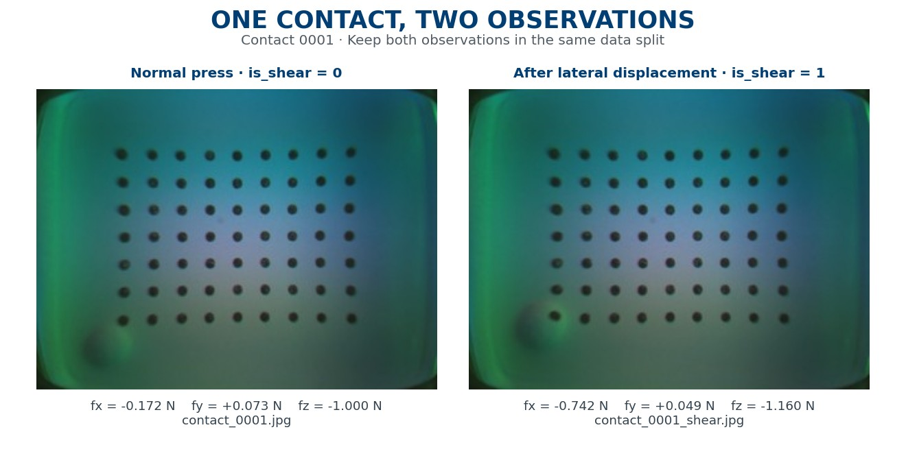

# Dataset Labels

[Home](../README.md) · [Simplified handbook](COURSEWORK_GUIDE.md)

[Download Tactile_DL_2027.zip](https://github.com/dianzdd123/2026-2027-Deep-Learning-Final-Coursework-Part-A/releases/download/v1.0.2/Tactile_DL_2027.zip).

## Files

Paths are relative to the extracted `Tactile_DL_2027/` folder.

| Path | Contents |
|---|---|
| `shape_classification/images/` | 2,000 shape images |
| `shape_classification/classes.csv` | Class names and IDs |
| `shape_classification/labels.csv` | `filename,class_name,class_id` |
| `force_regression/images/` | 2,000 force images |
| `force_regression/labels.csv` | `filename,contact_id,is_shear,fx,fy,fz` |

Each CSV's `filename` is relative to its task folder. For example, join a shape filename to `Tactile_DL_2027/shape_classification/`.

## Shape classes

There are 200 images per class. Use this mapping in training and prediction.

| ID | Class |
|---:|---|
| 0 | cylinder |
| 1 | dots |
| 2 | hexagon |
| 3 | line |
| 4 | moon |
| 5 | rectangle |
| 6 | ring |
| 7 | small_sphere |
| 8 | triangle |
| 9 | wave |

## Force labels

| Column | Meaning |
|---|---|
| `contact_id` | Contact identifier; keep its two images in the same split |
| `is_shear` | `0`: press; `1`: shear |
| `fx,fy` | Tangential force components in newtons |
| `fz` | Normal force in newtons; negative means pressing into the sensor |

Use `contact_id` for splitting and `is_shear` for evaluation only. Predict forces from image pixels.

The archive's “Task A” and “Task B” refer to shape and force respectively; both belong to **coursework Part A**.

Source: TacVerse — [doi:10.1002/adrr.70169](https://doi.org/10.1002/adrr.70169).
